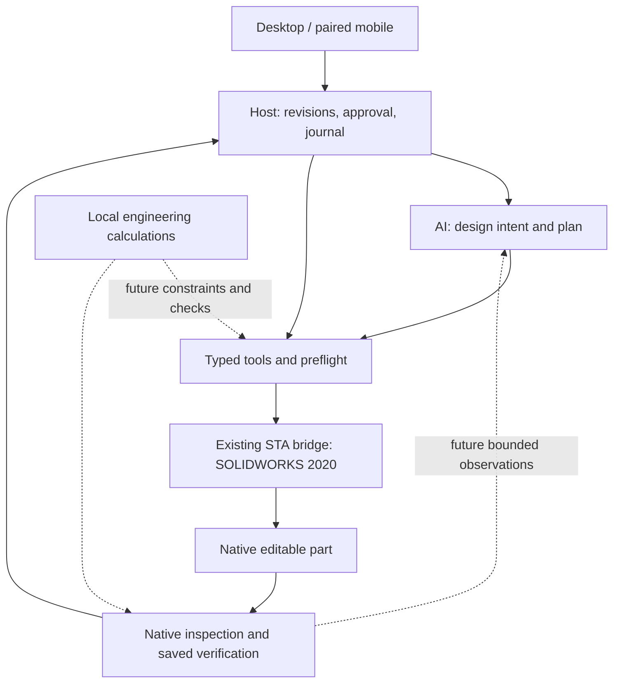

# Open-source investigation and implemented verification increment

Session date: 29 October 2026 (Perth). This is an implementation handoff, not native certification.

## A. Existing system assessment

The actual baseline is `jhaago/SolidWorks-CAD-Agent`, branch `feature/parametric-edit`,
commit `e3a909df3478ae45abe5977c28708e1f4cb8607d`. `main` is an obsolete starting point.
The chosen branch contains the image-intake and newer parametric plate/hole/edit work.
Changes are isolated on local branch `feature/open-source-verification-2020`.

Retain these working components:

| Component | Source and observed behavior |
|---|---|
| Reasoning/planning | `AgentHost/Ai/OpenAiCadPlanningProvider.cs`: bounded Responses API output, strict command whitelist, credential abstraction. Design intake has revisioned engineering briefs before CAD approval. |
| Tool contracts | `Core/Commands/CadOperationDescriptor.cs`, `CadPlanningCommandContract.cs`, versioned plans/preflight: exact operations, units and geometry restrictions. Fifteen legacy planner operations; a capability-matrix row is not an executable tool. |
| Host control | `AgentHost/Jobs/JobCoordinator.cs`: persisted revisions/current approval, native-control lease, sequential dispatch, fail-stop jobs and verification. Deterministic explicit parametric requests avoid provider ambiguity. |
| COM boundary | `SolidWorksBridge/Session`, `Threading/SolidWorksStaDispatcher.cs`: one owning STA, bound document checks, SOLIDWORKS version handling, installed native interop isolated behind contracts. |
| Native modelling | Origin-plane rectangle/circle/slot/polygon or closed simple line/arc profiles, boss/cut. V2 analytical restrictions and post-save checks are deliberate reliability boundaries. |
| Parametric constraints | `ParametricRectangleBuilder`, `ParametricHoleBuilder`, associated inspectors: native named driving dimensions, actual relation attachments, solver status, persistent role ownership; not merely fixed traced geometry. |
| Inspection/delivery | Precise six-direction body extents, rebuild checks, analytical volume/profile expectations, saved/reopened native evidence and hash-bound artifact authorization. |
| Editing/recovery | Checkpointed edits to six named plate/hole roles, source authorization and immutable source protection, child model/checkpoint/reopen validation, durable attempts and no replay of uncertain mutations. |
| UI | WinForms + loopback Host; paired RemoteAgent forwards a narrow approved job API. Android companion is separate; it was not modified here. |

The repository's 13 October verification documents record earlier SOLIDWORKS 2020
native successes and 762 unit tests in both interop modes. Those are historical
records, not reruns of this branch. The baseline GitHub Actions run
[38395646337](https://github.com/jhaago/SolidWorks-CAD-Agent/actions/runs/38395646337)
is successful at the exact baseline SHA; it does not validate these new changes.

Observed weaknesses and boundaries:

- Shared boss/cut helpers previously accepted any non-null feature. Final Host checks
  were useful, but an intermediate no-op could be reported as successful.
- Feature inspection only followed `GetNextFeature`; absorbed sketches/subfeatures
  could be omitted. Body volume was returned only for exactly one solid.
- The existing STA queue has no message pump/busy-call filter or durable in-flight
  timeout quarantine comparable to the external projects. A timeout cannot cancel COM.
- V2 selection/reference management is valuable; generic stable face/edge selection
  remains missing. Edge-finishing source is explicitly excluded from compilation.
- General constraints, multiple boss unions, face sketches, revolve, patterns,
  assemblies and drawings must not be advertised merely because source drafts or
  capability-matrix entries exist.
- Current `CadPlanningRequest` carries prompt/clarifications/image, not a live model
  observation loop. Persisted inspection evidence is not yet conversational AI verification.

## B. Open-source comparison, pinned to inspected source

Both complete repositories were cloned read-only; their build/install scripts were
not executed. Selected source, contracts, dependencies and tests were inspected.
No third-party live-test claim was reproduced inside SOLIDWORKS here.

| Area | Project A: soheil-mp/solidworks-mcp | Project B: czuryk/SolidworksMCP |
|---|---|---|
| Inspected SHA | `f450dabcd02a9a7ba705ee9e18a77aaeee9fe802` | `eccb8af4aa76416baf2a5ca99b256da19b73d9b6` |
| Host/execution | C# .NET 10 Windows; typed embedded COM interop; MCP SDK wrappers over services; owning STA and OLE busy-call filtering | Python MCP, pywin32, typed/dynamic COM helpers, dedicated STA, pumped COM and durable operation/journal/lease state |
| Parametric sketching | `SketchEditService`: dimensions, relations, reopen, edits, patterns, inspection | `parametric.py`: named entities, relation graph validation, batch dimensions, equations, solve status and DOF analysis |
| Features | Real service implementations for boss/cut, revolve, fillet/chamfer, shell, holes, patterns, mirror, sweep/loft and more; not just declarations | Real parametric/advanced feature modules and shape compiler for extrudes/cuts, revolves, sweeps/lofts, patterns and Boolean-dependent native shape programs |
| Modification/selection | Persistent entity registry, geometric queries, feature management and dimension setting | Persistent entity mappings, shape reconciliation, same-topology parameter edits and revision checks |
| Assemblies | `AssemblyService`, patterns/explode modules: insertion, mates, movement, replacement and interference; `AddMate5` and mate readback are present | Reviewed public modelling/shape path is primarily part and multibody construction. It is not a verified substitute for A's assembly/mate subsystem. |
| Drawings | Substantial `DrawingService` and annotation/table modules, corresponding live test sources | No comparably reviewed native drawing-generation subsystem; do not infer one from export tooling. |
| Inspection | Feature identity/type/error, per-body mass/area/topology, geometric/intent checks and result evidence | Native geometry/kernel checks, reference-image comparison, dimensions/fit checks and delivery manifests |
| Recovery | New-feature set difference and deletion; reports incomplete cleanup. This is not restoration of every existing-model edit. | Native file checkpoints/manifests/hashes, dirty-document checks, restored-file reopening; transaction and unknown-outcome quarantine code exists. |
| Image-to-sketch | No comparable raster pipeline in reviewed tool services | Real silhouette/line-art pipeline, graph recovery, fitting, reverse-raster checks and optional neural models. `locked_trace` can use Fix relations; fully defined tracing does not automatically encode design intent. |
| Tests/reliability | Offline CI deliberately compiles interop-free sources; Core/Server/live compilation needs an installation. README reports 352 live tests on 2025 SP1.2 and documents hangs/long-session issues. Test source exists; passing all on 2020 is unproven. | Extensive pure/mock and live scripts exist. Server identifies 2025/2026, with explicit 2026 SP2.1 notes and many 2026 workarounds. No reproduced 2020 compatibility evidence. |
| Dependencies | New .NET runtime/MCP/logging plus local sldworks/swconst/cosworks assemblies; newer APIs must be audited individually | Broad Python scientific stack; optional Torch/Transformers/Hugging Face and CUDA-dependent paths. Several requirements use lower bounds, increasing reproducibility cost. |
| Security/data | Read-only/ownership/path controls, optional arbitrary VBA off by default. MCP clients may send returned geometry/screenshots to their model provider. | Raw Python execution compiles/executes code with SW context; a watchdog is not a code sandbox. Model loaders reviewed use cached `local_files_only=True`; provisioning weights is separate. Tool outputs may still leave through the model client. |
| SOLIDWORKS 2020 | Not drop-in certified. .NET 10 alone does not determine COM API compatibility, but newer interop symbols/runtime dependencies prevent direct net48 reuse. | Late binding does not imply compatibility. Return shapes/constants/new API calls and 2026-specific paths need dedicated 2020 tests. |

Primary source links at the inspected revisions:

- [A source tree](https://github.com/soheil-mp/solidworks-mcp/tree/f450dabcd02a9a7ba705ee9e18a77aaeee9fe802), particularly `Verify/FeatureVerifier.cs`, `Verify/Snapshot.cs`, `Geometry/Tree.cs`, `Com/StaDispatcher.cs`, `Services/SketchEditService.cs`, `Services/AssemblyService.cs` and `Services/DrawingService.cs` under `src/SolidWorksMcp.Core`.
- [B source tree](https://github.com/czuryk/SolidworksMCP/tree/eccb8af4aa76416baf2a5ca99b256da19b73d9b6), particularly `solidworks_mcp/automation/{parametric,transactions,sta_executor,model_inspection,vectorization}.py`, `server.py`, `requirements.txt`, and `tests`.
- [2020 body mass-properties API](https://help.solidworks.com/2020/english/api/sldworksapi/solidworks.interop.sldworks~solidworks.interop.sldworks.ibody2~getmassproperties.html?format=P&value=): 12 solid-body values, SI volume at index 3; existing agent already uses this API.
- [2020 subfeature traversal API](https://help.solidworks.com/2020/english/api/sldworksapi/SOLIDWORKS.Interop.sldworks~SOLIDWORKS.Interop.sldworks.IFeature~GetNextSubFeature.html).

### Licence and incorporation decisions

A's root licence is MIT, copyright 2026 Soheil and the solidworks-mcp contributors.
B's root licence is MIT, copyright 2026 Samsaam Ali Baig. Copying substantial code
requires retaining the copyright and permission notice; neither root licence requires
releasing our own source. Dependencies, SOLIDWORKS binaries and downloaded model weights
have separate obligations. B's optional DexiNed/TEED exports list separate MIT notices;
other optional checkpoints must be checked individually before redistribution.

This increment copies no third-party implementation code, runtime or weights. It
independently implements a measured material-change pattern observed in A, with stricter
fail-closed raw-array validation and existing project interfaces. No imported-code notice
is required for that independently written implementation; the provenance remains here.

| Decision | Feature/component | Reason and disposition |
|---|---|---|
| C — independently implemented now | Per-operation material evidence; complete bounded nested inspection | Direct benefit to all current boss/cut callers; compatible old APIs; no second runtime or scheduler. |
| B — adapt approach next | A's geometric entity query/cardinality contracts | Extend our persistent-reference model; do not select arbitrary first faces or substitute names for identity. Prerequisite to fillets/face sketches. |
| B — adapt approach next | B's named constraint graph + explicit solve target | Preserve current tested plate/hole builders; generalize around entity IDs, conflicts, dimensional attachment and solver readback. |
| B — adapt selectively | A's OLE filter/message pump and B's durable timeout/quarantine semantics | Queue cancellation and in-flight unknown outcomes must be distinct; no blind mutation retry. A separately native-tested reliability increment. |
| B — adapt later | B's tracing/reverse-raster validation | Separate local perception worker; recover analytic primitives and uncertainty before design-intent constraints. Avoid bringing CUDA/scientific libraries into the COM process. |
| C — independently implement | MCP facade over current Host contracts | Optional transport only; retain validation, current approval, leases, references and journals. No duplicate tool execution path. |
| C — independently implement | Small verified revolve/pattern/fillet adapters | Use 2020 documented signatures, semantic entity selection, independent native readback and saved acceptance before catalogue exposure. |
| D — reject now | Wholesale replacement with A or B | Duplicates existing safety/persistence and introduces unverified API/runtime behavior. Existing agent is more complete than the brief's initial feature list. |
| D — reject | Raw VBA/Python execution exposed to the planner | Bypasses typed operations and approval/identity controls; watchdogs do not constrain filesystem/network access. |
| D — reject as universal recovery | Deleting a set of newly named/features IDs | Can remove dependencies and cannot undo arbitrary edits to existing geometry. Keep checkpointed native-file restoration with verified hashes/reopen. |
| D — defer expansion | Assemblies, drawings, FEA and heavyweight perception runtime | Valuable future modules; neither advertised breadth nor MIT licence proves 2020 behavior or engineering validity. |
| A — direct adoption | None this increment | No isolated drop-in component provides enough benefit over the existing net48 boundary without porting and native validation. This is an evidence-based decision, not a prohibition on later licensed reuse. |

## C. Recommended architecture

Keep process boundaries; add capabilities inside them. The layers are responsibilities,
not six new services. Engineering checks start as pure local modules.

MCP, if added, calls the same Host admission path. It must not supply trusted execution
IDs, elevate edit permissions or bypass approval. Return bounded model observations,
units, uncertainty, revision and native evidence to the reasoning layer. Keep calculated
engineering checks separate from native geometry and from AI narrative conclusions.

## D. Implemented changes

| Files (relative to repository root) | Change |
|---|---|
| `src/SolidWorksCadAgent.SolidWorksBridge/Inspection/SolidMaterialSnapshot.cs` | Immutable all-solid count/volume, full 12-value finite mass-array validation, SI→mm³ conversion and aggregate overflow rejection. Empty part is zero; missing readback is an error. |
| `Inspection/MaterialChangeVerifier.cs` | Signed boss/cut volume delta, body delta, evidence version and explicit numerical detection threshold: max(0.000001 mm³, 1e-12 × larger total volume). This is not a manufacturing tolerance. |
| `Inspection/FeatureMaterialOperation.cs` | Measure→single mutation→native health→measure→material check→result projection; typed failure retains pre/post evidence and whether mutation was attempted. No retry/rollback. |
| `Inspection/NativeFeatureMaterialVerifier.cs` | Old SOLIDWORKS COM adapters, feature-type normalization, clean rebuild checks, result evidence and explicit possibly-modified/no-rollback failure data. All inside the owning STA. |
| `Commands/FeatureCommandHandlers.cs` | Shared boss/cut helpers now use verification. Legacy, V2 sketch-selected and parametric boss paths benefit through these shared calls. Existing success fields remain, plus `materialVerification`. |
| `Commands/InspectionCommandHandlers.cs` | `GetBodyCount` returns total volume across hidden and visible solids; unavailable material fails instead of becoming null success. |
| `Inspection/BoundedFeatureTraversal.cs`, `Inspection/SolidWorksInspector.cs` | Inspect nested subfeatures; bounded 10,000 encounters / depth 64, deduplicate repeated references, fail cycles/limits. Parent/depth fields are additive first-traversal metadata. |
| `tests/SolidWorksCadAgent.UnitTests/{MaterialChangeVerifierTests,FeatureTraversalTests}.cs` | New pure regression tests for measurements, invalid/overflow input, wrong-sign/no-op results, partial state, result failure and graph traversal. |
| `tests/SolidWorksCadAgent.UnitTests/CadResultJsonRegressionTests.cs` | Preserve exact camel-case contract, including new ancestry fields. |
| `tests/SolidWorksCadAgent.PortableTests/*.csproj` | Links exact production sources and the new/relevant existing tests into the official MSTest runner on net8; production projects remain net48. |
| `.github/workflows/unit-tests.yml` | Adds a Linux portable policy-test job beside the existing full Windows checks; remote execution is pending publication. |
| `tests/SolidWorksCadAgent.IntegrationTests/PrismaticCapabilityTests.cs` | Native fixture assertions for material evidence, all-solid hidden/multibody volume, absorbed profile visibility and deduplication before/after save/reopen. Not executed here. |
| `docs/superpowers/{specs,plans}/2026-10-29-*`, this report, Windows acceptance note | Design decisions, implementation and verification handoff. |

New expected failures: `FEATURE_MATERIAL_PREFLIGHT_FAILED` before mutation and
`FEATURE_MATERIAL_VERIFICATION_FAILED` after an attempted mutation. Existing Host
fail-stop and uncertain-model handling remain authoritative. Creation failures can
leave a test-owned document modified; no deletion/restoration is claimed. Existing
checkpointed edit recovery remains unchanged. The material test does not prove exact
shape, hole location, dimensions, absence of internal flaws or manufacturability.

## E. Verification and review

- Baseline net48 solution compilation succeeded without installed interop; five existing
  async-without-await warnings in native-disabled integration fixtures.
- Updated full net48 unit-test project compilation succeeded with zero warnings/errors.
- Official portable MSTest runner: **53 passed, 0 failed, 0 skipped**. It includes 46
  material/traversal cases and seven existing JSON/bounds regression cases.
- The VSTest host initially crashed before execution in `ShouldRunInProcess` on this
  environment. Direct MSTest invocation established early results; the final authoritative
  portable run uses the package's official in-process executable runner, not a custom runner.
- An existing exact JSON-key test initially failed (expected four fields, now six); it
  was updated for the deliberate additive contract and passes. Nothing was silently ignored.
- Independent review: no Critical, two Important and one Minor. Full raw native arrays and
  result projection/serialization after mutation were the Important gaps; both have regression
  coverage and fixes. Minor deferred: a sketch returned first as a root retains root ancestry
  if also returned under its owner. Error inspection still happens; do not use these display
  fields as semantic selection identity. Native hierarchy reconciliation needs a 2020 fixture.
- No native-enabled compile, Windows full-suite execution, SOLIDWORKS launch, saved part,
  live AI plan or cloud API call was performed here. No new native acceptance is claimed.
- Attempting the full net48 suite locally also aborted in the VSTest host before execution;
  the unit project compiled, but its full runtime suite is not marked passing.
- Publication of the branch was blocked by automatic approval review because the remote is
  public and explicit publication authorization was absent. Local commits remain; no new
  remote CI validation or draft PR is claimed. Do not conflate the baseline CI with this work.

Exact reproducible commands and milestone limits are in
`docs/windows-acceptance-open-source-2026-10-29.md`.

## F. Prioritized continuation

1. On the 2020 PC: compile against the installed 2020 assemblies; run the entire unit
   suite, the changed prismatic fixtures and parametric plate/hole/edit regressions.
   Check subfeature IDs/ordering, native return array shape and rebuild behavior before merging.
2. Close the requested milestone honestly: use existing six-driving-parameter plate/hole
   workflow and checkpointed edits; add meaningful feature names and a fixture that consumes
   persisted observations through the AI response layer. A true angled mounting bracket and
   multi-hole constraints extend the current bounded scope; do not call a flat plate an L-bracket.
3. Semantic face/edge resolver: persistent references + geometry filters + expected cardinality,
   configuration/revision binding and ambiguity rejection. Then enable one native-tested
   fillet/chamfer and planar-face sketch adapter.
4. General parametric sketches: named entities, typed relation graph, driving dimensions,
   units, solver/readback, conflict diagnostics and checkpoints. Preserve the tested plate/hole
   recipes while generalizing; no automatic Fix-all workaround for design intent.
5. Bounded conversational editing: feed native observations/revisions into reasoning, return
   a validated proposed delta plan, retain current approval and immutable-source checkpoints.
6. Local image interpretation worker: recover lines/arcs/circles, scale/view assumptions,
   OCR dimensions and uncertainty; present a design brief before native construction. Treat
   silhouette tracing as reference evidence, not an inferred mechanical feature tree.
7. Engineering intelligence: pure dimensionally checked calculations and explicit assumptions
   for section strength, clearances, load paths and manufacturing constraints; validate with
   independent examples before adding assembly/drawing/FEA workflows.

The end-to-end target remains: hand sketch → reviewed design intent → constrained analytic
sketches/features → native inspection → engineering checks → approved conversational edits.
